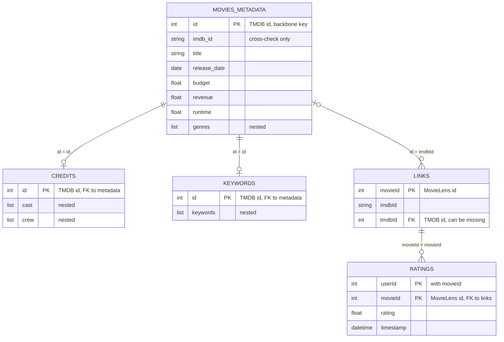

# Relationship Diagram

**Project:** Movie Intelligence
**Stage:** 1, Understand the Raw Data (final deliverable)
**Last updated:** 2026-10-11
**Evidence:** `4_metadata_summary.md` (counts), `6_data_dictionary.md` (columns), `7_cleaning_decisions.md` (decisions C01 to C30)

> **How to read this.** The diagram describes the tables **after** the cleaning decisions are applied (duplicates removed, split records repaired). Where the raw data breaks a relationship, the exception is listed with its count. Every number comes from my notebook outputs.

---

## 1. The diagram



If the viewer does not render Mermaid, use the plain-text version below.

---

## 2. Plain-text version

```
        TMDB id system                                   MovieLens id system
 ┌───────────────────────────┐                      ┌───────────────────────┐
 │ MOVIES_METADATA           │   1 : 0..many        │ LINKS  (the bridge)   │
 │ id  (PK, TMDB)            │◄─────────────────────│ movieId (MovieLens PK)│
 │ imdb_id                   │   id = tmdbId        │ tmdbId  (FK, nullable)│
 └───────────────────────────┘                      │ imdbId                │
        │ 1 : 0..1      │ 1 : 0..1                  └───────────────────────┘
        │ id = id       │ id = id                              │ 1 : 0..many
        ▼               ▼                                      │ movieId = movieId
 ┌─────────────┐  ┌─────────────┐                              ▼
 │ CREDITS     │  │ KEYWORDS    │                  ┌───────────────────────┐
 │ id (PK/FK)  │  │ id (PK/FK)  │                  │ RATINGS               │
 │ cast, crew  │  │ keywords    │                  │ (userId, movieId) PK  │
 └─────────────┘  └─────────────┘                  │ rating, timestamp     │
                                                   └───────────────────────┘

 The only path from RATINGS to MOVIES_METADATA goes through LINKS.
 IMDb ids (metadata.imdb_id and links.imdbId) are a cross-check, not a join key.
```

---

## 3. Cardinality of each relationship

| Relationship | Cardinality | Evidence (after cleaning) | Exceptions in the raw data |
|---|---|---|---|
| `movies_metadata` to `credits` on `id` | **1 to 0..1** | 45,433 metadata ids, 45,432 credits ids. Every credits id is in metadata. | Raw `credits` has 44 extra copies of ids (removed by C04, C05). Metadata id **401840** has no credits row. |
| `movies_metadata` to `keywords` on `id` | **1 to 0..1** | Same 45,432 ids as `credits`. | Raw `keywords` has 987 extra copies (removed by C03). Metadata id **401840** has no keywords row. |
| `credits` to `keywords` on `id` | **1 to 1** | The two tables hold exactly the same 45,432 ids. | None after de-duplication. |
| `movies_metadata` to `links` on `id = tmdbId` | **1 to 0..many** (and each links row has 0 or 1 metadata movie) | 45,433 metadata ids are all found among `links.tmdbId`. | 30 repeated `tmdbId` values (59 movies share one), so a metadata movie can match two `movieId` values. 219 `links` rows have no `tmdbId`. 161 `tmdbId` values are not in metadata. |
| `links` to `ratings` on `movieId` | **1 to 0..many** | All 45,115 rated movie ids are in `links`. | 728 `links` movies have never been rated. |
| `ratings` (users and movies) | **many to many** | One user rates many movies (270,896 users) and one movie is rated by many users. | `ratings` is the junction table. Its key is (`userId`, `movieId`), with 0 repeats. |
| `movies_metadata.imdb_id` to `links.imdbId` | **1 to 1** expected | 45,322 of 45,387 comparable movies agree (99.86%). | 65 disagree (63 are ids `links` has never seen, 2 point to another movie). 17 missing and one `'0'` placeholder in metadata. |

**Reading the notation:** "1 to 0..1" means each movie has at most one credits row, and each credits row belongs to exactly one movie. "1 to 0..many" means a movie can have no rows or several.

---

## 4. Relationships hidden inside the data

Some columns hold a list in each cell. Exploding them reveals further relationships that the table-level diagram does not show.

| Inside | Relationship | Cardinality |
|---|---|---|
| `movies_metadata.genres` | movie to genre | **many to many** (a movie has several genres, a genre has many movies) |
| `movies_metadata.production_companies` | movie to company | many to many |
| `movies_metadata.production_countries` | movie to country | many to many |
| `movies_metadata.spoken_languages` | movie to language | many to many |
| `movies_metadata.belongs_to_collection` | movie to collection | **many to one** (a collection holds several movies, a movie is in at most one) |
| `keywords.keywords` | movie to keyword | many to many |
| `credits.cast` | movie to person | many to many (a person acts in many movies) |
| `credits.crew` | movie to person | many to many |

This is why a **keyword shared by many movies is normal**, while the **same movie id appearing in two rows** of `keywords` is a data problem. They sit at two different levels: values inside the list versus rows in the table.

---

## 5. Join recipes and what to expect

| Goal | Path | Join type | Expected result |
|---|---|---|---|
| Movie details with cast, crew and keywords | `movies_metadata` ⟕ `credits` ⟕ `keywords` on `id` | **Left joins** from metadata | 45,433 rows. 45,432 match. Movie 401840 keeps empty cast, crew and keywords (C13). |
| Ratings with movie details | `ratings` → `links` → `movies_metadata` | Join `ratings.movieId` to `links.movieId`, then `links.tmdbId` to `movies_metadata.id` | 44,741 of 45,115 rated movies reach metadata (99.17%). 99.84% of rating rows. 44,682 after excluding the 59 shared-`tmdbId` movies (C12). |
| Cross-check the IMDb id | `movies_metadata.imdb_id` against `links.imdbId` rebuilt as `tt` plus 7 digits | Compare only | 45,322 agree, 65 disagree (C15, C17). |

**After every join, check the row count.** If a join returns more rows than its left side, something is repeated.

**Never do this:** `ratings.movieId` = `movies_metadata.id`. The two columns are different numberings. 83.2% of rated movies match nothing, and the rest match the wrong film. Pandas raises no error (C09).

**Worked trace:** any rating row with `movieId` 1 points to the `links` row with `movieId` 1, which holds `tmdbId` 862. Metadata row `id` 862 is Toy Story.

---

## 6. Silent risks (the ones that raise no error)

| Risk | Where | Effect | Guard |
|---|---|---|---|
| Joining ratings straight to metadata | `ratings` and `movies_metadata` | Lost and wrong matches | C09 |
| Repeated `tmdbId` in `links` | `links` | Ratings of two movies pooled, or one movie appearing twice | C12 (exclude and flag), C14 (row-count checks) |
| Duplicate ids in `credits`, `keywords`, `movies_metadata` | all three | Rows multiply on join | C03 to C07 |
| IMDb id format mismatch | `movies_metadata`, `links` | A raw join matches nothing | C15 |
| `userId` numbered differently in the small file | `ratings_small` and `ratings` | User-level results corrupted if mixed | C29 |
| Placeholder values (0, `'[]'`, `'0'`) | several columns | Averages and ratios distorted | C16 to C25 |

---

## 7. The small files

`links_small` and `ratings_small` have the same shape as `links` and `ratings`.
- `links_small` agrees with `links` on all 9,115 shared ids.
- `ratings_small` is a sample of `ratings` (99.67% of its distinct combinations match) with users renumbered.
- The project uses the full files (C29). Never combine `userId` values across the two files.