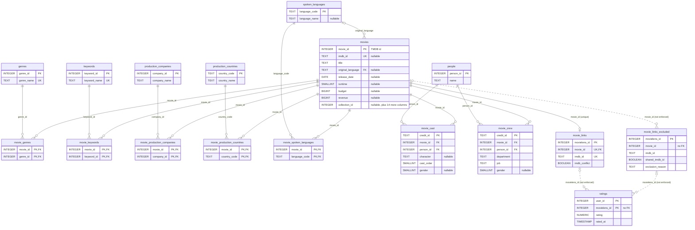

# ER Diagram: Processed Data

**Project:** Movie Intelligence
**Stage:** 3, Design the PostgreSQL Database (step: relationships)
**Evidence:** `8_relationship_diagram.md` (raw data), `29_data_types.md` (columns and keys), `28_stage2_summary.md` (counts), and a check of the processed CSVs for orphan rows

> **How to read this.** The Stage 1 diagram described the five **raw** files. This one describes the 17 **processed** tables that will become the PostgreSQL schema.
> - A **solid line** is a foreign key that the database will enforce.
> - A **dashed line** is a real relationship in the data that the database will **not** enforce, for a reason given in section 4.

---

## 1. The diagram



If the viewer does not render Mermaid, use the plain-text version below. The full column list of every table is in `29_data_types.md`.

---

## 2. Plain-text version

```
LOOKUP TABLES              LINK TABLES                       CORE              CREDIT TABLES        PEOPLE
(small, id + name)         (many-to-many)

genres ──────────────< movie_genres >──────────────┐
keywords ────────────< movie_keywords >────────────┤
production_companies ─< movie_production_companies >┤
production_countries ─< movie_production_countries >─┼───>  MOVIES  <─┬─< movie_cast ───>─┐
spoken_languages ────< movie_spoken_languages >─────┤          ▲     └─< movie_crew ───>─┼── people
        │                                           │          │                         ┘
        └─────────────< movies.original_language ───┘          │ 1 : 0..1
                                                               │ (movie_id is UNIQUE)
 ─ ─ ─ ─ ─ ─ ─ ─ ─ MOVIELENS SIDE ─ ─ ─ ─ ─ ─ ─ ─ ─ ─ ─ ─ ─ ─ ─│─ ─ ─ ─ ─ ─ ─ ─ ─ ─ ─ ─ ─
                                                          movie_links ┄┄┄┄┄┄┄┄┄┐
                                              movie_links_excluded ┄┄┄┄┄┄┄┄┄┤  dashed: logical,
                                              (no FK to movies)            ▼  not enforced
                                                                        ratings

 Solid = foreign key enforced by the database.
 Dashed (┄) = relationship exists in the data, but the database does not enforce it.
 The only path from ratings to movies goes ratings -> movie_links -> movies.
```

---

## 3. Every relationship

### 3.1 Enforced (16 foreign keys)

| Child table (many side) | Column | Parent table (one side) | Cardinality | Orphan rows found |
|---|---|---|---|---|
| `movie_genres` | `movie_id` | `movies` | many to one | 0 |
| `movie_genres` | `genre_id` | `genres` | many to one | 0 |
| `movie_keywords` | `movie_id` | `movies` | many to one | 0 |
| `movie_keywords` | `keyword_id` | `keywords` | many to one | 0 |
| `movie_production_companies` | `movie_id` | `movies` | many to one | 0 |
| `movie_production_companies` | `company_id` | `production_companies` | many to one | 0 |
| `movie_production_countries` | `movie_id` | `movies` | many to one | 0 |
| `movie_production_countries` | `country_code` | `production_countries` | many to one | 0 |
| `movie_spoken_languages` | `movie_id` | `movies` | many to one | 0 |
| `movie_spoken_languages` | `language_code` | `spoken_languages` | many to one | 0 |
| `movie_cast` | `movie_id` | `movies` | many to one | 0 |
| `movie_cast` | `person_id` | `people` | many to one | 0 |
| `movie_crew` | `movie_id` | `movies` | many to one | 0 |
| `movie_crew` | `person_id` | `people` | many to one | 0 |
| `movie_links` | `movie_id` | `movies` | **one to one** (`movie_id` is `UNIQUE`) | 0 |
| `movies` | `original_language` | `spoken_languages` | many to one (nullable) | 0 |

"Orphan rows found" is a check of the processed CSVs: every child value exists in its parent table. If it were not 0, the load would fail.

### 3.2 Not enforced (3 logical relationships)

| Relationship | Cardinality | Why there is no foreign key |
|---|---|---|
| `ratings.movielens_id` to `movie_links.movielens_id` | many to 0..1 | 52,160 ratings (0.20%) have no safe bridge row. A foreign key would reject them, and they are kept on purpose. |
| `ratings.movielens_id` to `movie_links_excluded.movielens_id` | many to 0..1 | Same reason: some ratings belong to movies whose link was excluded. Part of the 52,160 comes from here. |
| `movie_links_excluded.movie_id` to `movies.movie_id` | many to 0..1 | 161 of its 190 distinct TMDB ids do not exist in `movies`. The table is a quarantine, and a foreign key would reject the rows it exists to record. |

### 3.3 Not in the diagram, on purpose

| Missing relationship | Reason |
|---|---|
| `ratings.user_id` to a `users` table | No `users` table (decision D14 in `29_data_types.md`). MovieLens has no user attributes. |
| `movies.collection_id` to a `collections` table | Collections stay as two columns in `movies` (D18). |

---

## 4. From 5 raw files to 17 tables

The raw files stored lists inside cells and joined by IDs that did not always match. The processed design separates every "many" into its own table.

| Raw file (Stage 1) | Became (Stage 3) | What changed |
|---|---|---|
| `movies_metadata` | `movies` | One row per movie, with scalar columns only. |
| `movies_metadata.genres` (list in a cell) | `genres`, `movie_genres` | Lookup table plus a link table. |
| `movies_metadata.production_companies` | `production_companies`, `movie_production_companies` | Same pattern. |
| `movies_metadata.production_countries` | `production_countries`, `movie_production_countries` | Same pattern. |
| `movies_metadata.spoken_languages` | `spoken_languages`, `movie_spoken_languages` | Same pattern. |
| `credits` (cast and crew lists) | `movie_cast`, `movie_crew`, `people` | One row per credit, plus one row per person. |
| `keywords` (list in a cell) | `keywords`, `movie_keywords` | Lookup table plus a link table. |
| `links` | `movie_links`, `movie_links_excluded` | Trusted mappings separated from the 220 excluded ones. |
| `ratings` | `ratings` | Same shape, with `timestamp` renamed to `rated_at`. |

The "hidden" many-to-many relationships from section 4 of the Stage 1 diagram are now real tables. The Stage 1 relationships `credits` to `movies_metadata` and `keywords` to `movies_metadata` ("1 to 0..1") became "one movie to many credit rows".

---

## 5. Reading the diagram: three patterns

1. **Link table (many-to-many).** A movie has several genres and a genre has several movies. The database cannot store that in two tables, so `movie_genres` holds one row per pair, with a composite primary key `(movie_id, genre_id)`. The foreign keys sit on the link table, which is the "many" side of both relationships. `movie_keywords`, `movie_production_companies`, `movie_production_countries` and `movie_spoken_languages` follow the same pattern.
2. **Credit table (one-to-many with its own key).** Each cast or crew row has a unique `credit_id` of its own, so it needs no composite key. Both `movie_cast` and `movie_crew` connect `movies` and `people`, so `people` is the many-to-many bridge between movies and the people in them.
3. **The two id systems.** `movies` uses TMDB ids. `ratings` uses MovieLens ids. They meet only in `movie_links`, and the dashed lines are where the database cannot guarantee the connection.

---

## 6. Join paths and what to expect

| Goal | Path | Expected result |
|---|---|---|
| Genres of a movie | `movies` to `movie_genres` to `genres` | Every row matches, because every link row has a parent. |
| Cast of a movie | `movies` to `movie_cast` to `people` | Same. |
| Ratings of a movie | `ratings` to `movie_links` to `movies` | 25,972,129 ratings reach a movie. 52,160 (0.20%) do not, and are reported as lost, never dropped silently. 44,682 of 45,115 rated movies are reached. |
| Movies never rated | `movies` to `movie_links` to `ratings` | Movies with no `movie_links` row, or none rated, appear only in an outer join. |

**After every join, compare the row counts.** The database now prevents some silent errors (duplicate bridge rows, links to movies that do not exist), but a wrong join is still possible.

**Never join `ratings.movielens_id` directly to `movies.movie_id`.** They are different numbering systems, and the database cannot stop you because both are integers.

---

## 7. Which Stage 1 risks the database now guards

| Risk (from the Stage 1 diagram) | Guard in the database |
|---|---|
| Duplicate ids in `movies`, `credits`, `keywords` | Primary keys reject them. |
| A link row pointing to a movie, person, genre or keyword that does not exist | Foreign keys reject it. |
| One TMDB id mapped to two MovieLens ids in the bridge | `UNIQUE` on `movie_links.movie_id`. |
| Placeholder values (0 for budget, 0 for rating average) | `CHECK (budget > 0)`, `CHECK (vote_average BETWEEN 0 AND 10)` and similar. |
| Joining ratings straight to metadata | **Not guarded.** Still a human responsibility. |
| `userId` mix-up with the small files | **Not guarded.** The small files are not loaded. |